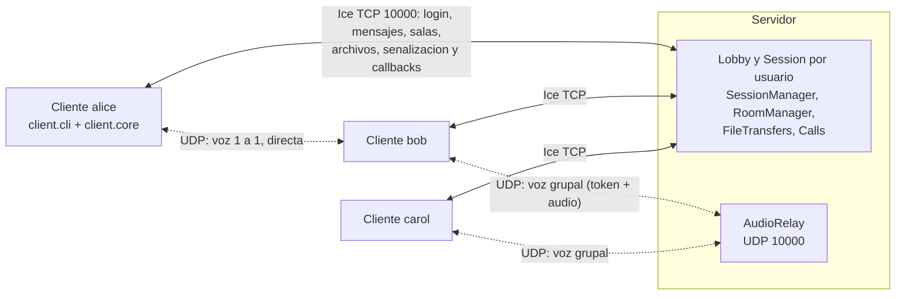
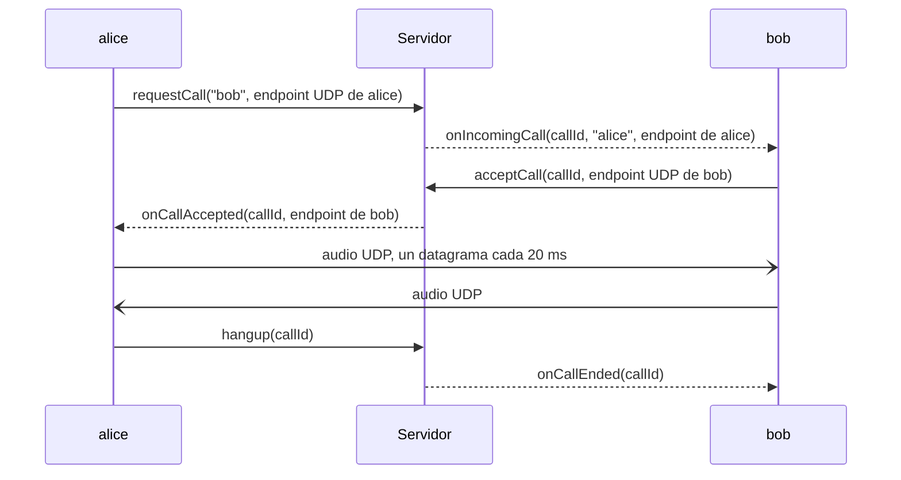

# ice-chat-project

Chat multimedia con ZeroC Ice (mensajeria, salas, archivos, senalizacion) y voz sobre UDP.
Taller Evaluativo Unidad 2 - Computacion en Internet I (Icesi, 2026-2).

## Setup

### Requisitos

| Herramienta | Version | Notas |
|---|---|---|
| JDK | **17 a 24** (recomendado Temurin 21) | `JAVA_HOME` debe apuntar a este JDK. Gradle 8.14 no corre sobre JDK 25+ |
| ZeroC Ice | **3.7.11** | Provee `slice2java`. Debe coincidir con la version `ice` de `gradle/libs.versions.toml` |
| Gradle | 8.14.3 (via wrapper) | No hace falta instalarlo; usar `./gradlew` |

### Instalacion en Windows

1. JDK 21: `winget install EclipseAdoptium.Temurin.21.JDK` (configura `JAVA_HOME`; abrir una terminal nueva despues).
2. Ice 3.7.11: descargar e instalar [Ice-3.7.11.msi](https://download.zeroc.com/ice/3.7/Ice-3.7.11.msi).
   El plugin de Gradle encuentra `slice2java` via el registro de Windows; si no, definir `ICE_HOME=C:\Program Files\ZeroC\Ice-3.7.11`.

En Linux/macOS: instalar Ice 3.7.11 segun https://zeroc.com/downloads/ice/3.7 (o definir `ICE_HOME`).
Con Homebrew en macOS el plugin busca en `/usr/local`, asi que hay que definir `ICE_HOME=/opt/homebrew/opt/ice@3.7`.

### Compilar y ejecutar

```bash
./gradlew build        # compila los .ice -> common/build/generated-src y todos los modulos
./gradlew runServer
./gradlew runClient
```

> **Por que Gradle 8 y no 9:** el plugin oficial `com.zeroc.gradle.ice-builder.slice` (1.5.2) usa
> `groovy.util.XmlSlurper`, que ya no existe en Gradle 9 (Groovy 4). Por la misma razon el
> configuration cache esta desactivado en `gradle.properties`.
>
> **Consola:** `gradle.properties` fija `org.gradle.console=plain` para que la barra de progreso de
> Gradle no se mezcle con la salida de la CLI. Para ocultar tambien las lineas de tareas: `./gradlew runClient -q`.

### Configuracion y red local

La configuracion de Ice esta en `server/config.server` y `client/config.client` (endpoints, hilos,
`Ice.MessageSizeMax`, heartbeats para detectar clientes caidos y `Relay.Port`, el puerto UDP del relay de
audio). Cualquier propiedad se sobrescribe con `--Nombre=valor`. Para conectar un cliente a un servidor en
otra maquina:

```bash
./gradlew runClient --args="--Lobby.Proxy='Lobby:tcp -h 192.168.1.10 -p 10000'"
```

El servidor usa el puerto 10000 en TCP (Ice) y en UDP (relay de las llamadas grupales). Los clientes reciben
los callbacks por la misma conexion del login (conexion bidireccional de Ice), asi que para el chat no abren
puertos; durante una llamada cada cliente usa un puerto UDP libre para el audio. En Windows hay que permitir
Java en la red local en la maquina del servidor y, para las llamadas 1 a 1 (el audio va directo entre los
clientes), tambien en los clientes.

## Manual de usuario (CLI)

Iniciar el servidor una vez y un cliente por usuario, cada uno en su propia terminal:

```bash
./gradlew runServer
./gradlew runClient -q
```

**Acentos en Windows:** Gradle reenvia la entrada y la salida del cliente en UTF-8. Antes de
`./gradlew runClient`, poner la terminal en UTF-8 con `chcp 65001`; si no, Gradle pierde las letras
con tilde y la `ñ` (llegan como `?`). Ejecutando el cliente con `java` directamente no hace falta.

| Comando | Descripcion |
|---|---|
| `/login <nick>` | Inicia sesion. El nickname es unico (sin distinguir mayusculas): 1 a 20 letras, numeros, `.`, `_` o `-`, sin espacios |
| `/users` | Lista los usuarios conectados |
| `/msg <nick> <texto>` | Envia un mensaje privado. `[ok]` confirma que el servidor lo recibio; `[error]` explica por que no (usuario inexistente, desconectado, ...) |
| `/rooms` | Lista las salas con su cantidad de miembros y si tienen una llamada activa |
| `/create <sala>` | Crea una sala y te une a ella. Mismas reglas que el nickname; `General` y `general` son la misma sala |
| `/join <sala>` | Te une a una sala (puedes estar en varias a la vez) y muestra sus miembros |
| `/leave <sala>` | Sales de la sala (y de su llamada, si estabas en ella); los demas miembros reciben el aviso |
| `/members <sala>` | Lista los miembros de una sala |
| `/r <sala> <texto>` | Envia un mensaje a todos los miembros de la sala menos a ti. Solo los miembros pueden escribir y leer la sala. `#sala` y `sala` funcionan igual |
| `/sendfile <nick> <ruta>` | Envia un archivo (imagen, audio, pdf, ...; hasta 1 GB) a un usuario. La ruta es el resto de la linea: puede tener espacios o ir entre comillas. Con `gradlew runClient` las rutas relativas parten de `client/`, asi que conviene usar rutas absolutas |
| `/sendfile #sala <ruta>` | Envia el archivo a todos los miembros de la sala menos a ti |
| `/call <nick>` | Llama a un usuario. Cuando contesta empieza el audio por UDP, directo entre los dos clientes |
| `/call #sala` | Entra a la llamada grupal de la sala (la empieza si no hay). Solo para miembros; el audio pasa por el relay del servidor |
| `/accept` / `/reject` | Contesta o rechaza la llamada entrante |
| `/mute` | Silencia o activa el microfono, en cualquier momento; se mantiene para las llamadas siguientes |
| `/hangup` | Cuelga la llamada 1 a 1 (o la cancela si aun timbra) o sale de la llamada grupal; los demas siguen hablando |
| `/logout` | Cierra la sesion (sales de todas tus salas y de tu llamada); el nickname queda libre |
| `/help` | Muestra los comandos |
| `/quit` | Cierra la sesion y sale (Ctrl+C hace lo mismo) |

Antes de `/login` solo funcionan `/login`, `/mute`, `/help` y `/quit`. Los eventos del servidor aparecen en cuanto
llegan, sin bloquear la escritura de comandos:

```
Chat Ice. Escribe /help para ver los comandos.
/login alice
Sesion iniciada como alice. Conectados (2): alice, bob
* carol se conecto
/msg bob hola bob
[ok] enviado a bob
[11:15] (privado) bob: hola alice
/msg nadie hola
[error] El usuario 'nadie' no existe o no esta conectado
* carol se desconecto
```

Salas: cada mensaje muestra la hora, la sala y el remitente. Las salas no se borran al quedar vacias.

```
/create general
Sala #general creada. Escribe en ella con /r general <texto>
* bob se unio a #general
/r general hola a todos
[ok] enviado a #general
[11:20] #general bob: hola alice
* bob salio de #general
```

Archivos: viajan en bloques de 64 KB y el receptor los guarda en `client/downloads/<su nick>/`. Al
terminar compara el SHA-256 con el que envio el emisor; si ya existe un archivo con ese nombre lo guarda
como `foto (1).png`. Mientras se envia un archivo se puede seguir chateando.

```
/sendfile #general C:\Users\alice\Pictures\foto.png
[archivo] enviando foto.png a #general...
[ok] foto.png enviado a #general
```

En cada receptor:

```
[archivo] alice envia a #general foto.png (1.2 MB)
[archivo] foto.png de alice guardado en C:\...\client\downloads\bob\foto.png (SHA-256 verificado)
```

Si el emisor se desconecta a mitad del envio, los receptores ven `envio cancelado` y se borra el archivo
parcial (`.part`). Si se cae un receptor, los demas reciben el archivo igual (el `.part` del receptor
caido queda en su carpeta).

Llamadas: usar audifonos (sin ellos el microfono capta el altavoz y se escucha eco). Cada usuario esta en
una sola llamada a la vez; llamar a alguien ocupado responde `[error] bob esta en otra llamada`. Si el
otro usuario se desconecta, la llamada termina sola.

```
/call bob
[llamada] Llamando a bob... (/hangup para cancelar)
[llamada] bob contesto. /mute para silenciar, /hangup para colgar
/mute
[llamada] Microfono silenciado
/hangup
[llamada] Llamada terminada
```

En bob:

```
[llamada] alice te esta llamando. /accept para contestar, /reject para rechazar
/accept
[llamada] En llamada con alice. /mute para silenciar, /hangup para colgar
[llamada] alice termino la llamada
```

Llamada grupal (hay que estar en la sala):

```
/call #general
[llamada] Entraste a la llamada de #general (ya estan: bob). /mute para silenciar, /hangup para salir
* carol entro a la llamada de #general
* bob salio de la llamada de #general
/hangup
[llamada] Llamada terminada
```

El audio es PCM de 16 kHz, 16 bits y mono, en paquetes de 20 ms. Si hablan varios a la vez, el cliente
los mezcla. Para que el retraso no crezca se descartan los paquetes que se acumulan (mas de 80 ms por
persona); un paquete perdido es un corte de 20 ms.

Si un cliente se cierra de golpe (proceso terminado o red caida), el servidor lo detecta por la conexion
cerrada o por la falta de heartbeats (unos 10 s) y avisa a los demas. Si se cae el servidor, el cliente
muestra `[error] Se perdio la conexion con el servidor` y permite volver a hacer `/login`. Si el servidor
cierra la sesion de un cliente que no respondio a tiempo, el cliente lo informa en el siguiente comando
(`El servidor cerro tu sesion`) y tambien permite volver a hacer `/login`.

## Estructura

```
common/   contrato Slice (src/main/slice/*.ice) -> clases Java generadas
server/   servidor Ice y relay UDP de audio  (./gradlew runServer)
client/   cliente CLI                        (./gradlew runClient)
  client.core  logica independiente de la UI (Ice, callbacks, UDP)
  client.cli   interfaz de consola
ai-use/   bitacora de uso de IA generativa
```

## Contrato Slice

Modulo `chat` (paquete Java `chat`), dividido en `common/src/main/slice/`:

| Archivo | Contenido |
|---|---|
| `Types.ice` | Structs y secuencias: `TextMessage`, `RoomInfo`, `FileInfo`, `FileChunk`, `AudioEndpoint`, `GroupCallMember`, `GroupCallInfo`; constantes `ChunkSize` (64 KB) y formato de audio (`AudioSampleRate`, `AudioPacketBytes`, ...) |
| `Exceptions.ice` | `ChatException` y sus subclases (`NicknameTakenException`, `InvalidNameException`, `UserNotFoundException`, `RoomNotFoundException`, `UserBusyException`, ...) |
| `Callbacks.ice` | Lo que implementa el cliente: `PresenceListener`, `MessageListener`, `RoomListener`, `FileListener`, `CallListener`, unidas en `ClientCallback` |
| `Server.ice` | Lo que implementa el servidor: `Lobby` (login) y `Session`, que hereda de `MessageOps`, `RoomOps`, `FileOps` y `CallOps` |

Flujo: el cliente obtiene el proxy `Lobby`, llama `login(nickname, callback)` y recibe un `Session*` propio;
todas las operaciones posteriores se hacen sobre esa sesion. Los archivos se envian con `startFileToUser/Room`
(metadatos + SHA-256, devuelve un `transferId`) seguido de `uploadChunk` por cada bloque de 64 KB. Las
llamadas 1 a 1 se negocian con `requestCall` / `acceptCall` / `rejectCall` / `hangup`, donde cada lado publica
su `AudioEndpoint` UDP. Las grupales usan `joinGroupCall`, que devuelve el endpoint del relay, el token del
participante y quienes ya estaban, y `leaveGroupCall`.

## Arquitectura

Dos canales: todo el control viaja por Ice sobre TCP y el audio por datagramas UDP.



- **Ice (TCP 10000).** Cada cliente abre una sola conexion. Por ella invoca su `Session` y por ella
  misma recibe los callbacks (conexion bidireccional), asi el servidor nunca abre conexiones hacia los
  clientes. El servidor detecta clientes caidos por esa conexion (cierre o falta de heartbeats).
- **Voz 1 a 1 (UDP directo).** Ice solo negocia la llamada: cada lado publica su `AudioEndpoint` y el
  servidor se lo pasa al otro. El servidor reemplaza la IP reportada por la que ve en la conexion (con
  varias tarjetas de red, como VirtualBox o WSL, el cliente puede reportar una IP inalcanzable); si el
  cliente esta en la misma maquina que el servidor, usa la IP del servidor que conoce el otro cliente.
- **Voz grupal (relay UDP).** Al entrar, el servidor asigna un token al participante. Cada datagrama lleva
  el token y 20 ms de audio; el relay comprueba que el token venga de la direccion de ese participante y lo
  reenvia a los demas de la sala. Cada cliente separa el audio por token y lo mezcla.
- **Concurrencia.** El estado compartido esta en colecciones concurrentes. Un usuario ocupa una sola
  llamada (`putIfAbsent`), los callbacks se envian asincronos y fuera de locks, y al cerrarse una sesion se
  limpian sus llamadas, archivos y salas, en ese orden.

Llamada 1 a 1:



## Respuestas al cuestionario

### 1. Arquitectura hibrida TCP/UDP

El control, el chat y los archivos necesitan que cada mensaje llegue completo, una vez y en orden: un
mensaje perdido o un bloque de archivo faltante es un error. TCP garantiza eso y Ice agrega contratos
tipados, excepciones y callbacks. La senalizacion de llamadas tambien va por Ice: perder un `acceptCall`
dejaria la llamada colgada.

La voz es tiempo real: cada datagrama lleva 20 ms de audio y uno que llega tarde ya no sirve. Con UDP un
paquete perdido es un corte de 20 ms, casi inaudible, y el siguiente se reproduce a tiempo. Si la voz
viajara por Ice/TCP:

- **Bloqueo de cabeza de linea:** TCP entrega en orden, asi que un segmento perdido detiene todo lo que
  viene detras hasta que se retransmite: en el mejor caso unas decenas de milisegundos y, si vence el
  temporizador de retransmision, 200 ms o mas, que se duplican con cada perdida seguida. El audio se corta
  y despues llega de golpe.
- **Latencia acumulada:** para no cortarse, el receptor necesitaria un buffer de cientos de milisegundos.
  En una conversacion mas de 150-200 ms ya se nota y mas de 400 ms la rompe.
- **Control de congestion:** ante perdidas TCP reduce su tasa, pero la voz necesita una tasa constante
  (unos 32 KB/s por persona).
- **Costo de Ice:** serian 50 invocaciones por segundo por persona, cada una con encabezado y despacho en
  el thread pool (y una respuesta si es twoway), compitiendo con el chat y los archivos en la misma conexion.

Con jitter, UDP mas un buffer chico (el cliente descarta lo que pase de 80 ms por persona) mantiene el
retraso acotado a costa de pequenos cortes.

### 2. Buffer y chunking en Ice

Una sola llamada con los 80 MB en un `sequence<byte>` arma un mensaje Ice de unos 80 MB, mayor que
`Ice.MessageSizeMax` (1024 KB por defecto). Lo probamos con este servidor: el emisor arma todo el mensaje en
memoria y lo empieza a enviar; el servidor lee solo el encabezado, ve el tamano, lanza
`MemoryLimitException` (`requested 83886175 bytes, maximum allowed is 1048576 bytes (see Ice.MessageSizeMax)`)
y cierra la conexion. El cliente recibe `SocketException` (o `ConnectionLostException`) y pierde la sesion.

Subir `Ice.MessageSizeMax` no es solucion: los dos lados tendrian el archivo entero en memoria, la conexion
quedaria ocupada mientras viaja y cualquiera podria agotar la memoria del servidor con mensajes enormes,
que es justo lo que el limite evita.

Con chunking el archivo viaja en bloques de 64 KB (`ChunkSize`), cada uno en su propia llamada
`uploadChunk(FileChunk{transferId, index, data})`, muy por debajo del limite. Los metadatos (`FileInfo`:
nombre, tamano, cantidad de bloques y SHA-256) se envian una vez con `startFileToUser/Room`. El servidor
reenvia cada bloque y responde cuando todos los receptores lo recibieron, asi el emisor no puede ir mas
rapido que ellos y nunca hay mas de un bloque por transferencia en memoria. El receptor escribe cada bloque
en `index * chunkSize` y al final verifica el tamano y el SHA-256.

Parametros que intervienen: `Ice.MessageSizeMax` (en `config.server` y `config.client`), `ChunkSize` en el
contrato, el thread pool del servidor (`Ice.ThreadPool.Server.Size/SizeMax`: cada subida ocupa un hilo
mientras espera a los receptores) y el `ice_invocationTimeout` de los callbacks (5 s: un receptor colgado
no frena la transferencia para siempre).

### 3. Escalabilidad: relay vs mesh

Con N participantes hablando a la vez y un paquete cada 20 ms (50 por segundo), cada datagrama ocupa
4 bytes de token + 640 de audio + 28 de UDP/IPv4 = 672 bytes, unos 269 kbit/s por flujo. Las cantidades
son paquetes por intervalo de 20 ms.

- **Mesh:** cada cliente envia N-1 paquetes por intervalo (uno a cada otro) y recibe N-1. En la red
  circulan N(N-1) paquetes por intervalo y el servidor no lleva audio.
- **Relay (nuestra eleccion):** cada cliente envia 1 paquete y recibe N-1. El servidor recibe N y envia
  N(N-1): su carga total es N + N(N-1) = N^2 paquetes por intervalo.

| N | Mesh: envia cada cliente | Relay: envia cada cliente | Relay: recibe el servidor | Relay: envia el servidor |
|---|---|---|---|---|
| 3 | 2 (0,5 Mbit/s) | 1 (0,27 Mbit/s) | 3 (0,8 Mbit/s) | 6 (1,6 Mbit/s) |
| 5 | 4 (1,1 Mbit/s) | 1 (0,27 Mbit/s) | 5 (1,3 Mbit/s) | 20 (5,4 Mbit/s) |
| 10 | 9 (2,4 Mbit/s) | 1 (0,27 Mbit/s) | 10 (2,7 Mbit/s) | 90 (24,2 Mbit/s) |

El mesh reparte la carga y tiene un salto menos, pero la subida de cada cliente crece con N y cada uno
debe conocer y alcanzar a todos los demas (firewalls, varias IPs). El relay mantiene constante la subida
de cada cliente, que solo habla con el servidor, a cambio de que el servidor cargue con N^2. En una LAN y
con salas chicas eso no es problema. Para salas grandes se podria reenviar solo el audio de quien habla o
mezclar en el servidor y enviar un solo flujo a cada cliente.

### 4. Transparencia y callbacks en Ice

Ciclo de vida en el cliente:

1. `Util.initialize` crea el communicator con `config.client`.
2. `createObjectAdapter("")` crea un adaptador sin endpoints (no escucha en ningun puerto) y se activa.
3. `addWithUUID(new CallbackI(...))` registra el servant con una identidad aleatoria y devuelve el proxy
   `ClientCallbackPrx`.
4. Antes del login, `lobby.ice_getConnection().setAdapter(adapter)` asocia el adaptador a la conexion
   saliente: lo que el servidor invoque por esa conexion se despacha en ese adaptador.
5. `login(nickname, callback)` envia el proxy; el servidor lo fija a la conexion por la que llego
   (`ice_fixed(current.con)`) y le pone un timeout de 5 s.
6. Cada callback (`onPrivateMessageAsync`, `onIncomingCallAsync`, ...) viaja por esa conexion. El cliente
   lo despacha en su thread pool de un hilo (en orden) y `CallbackI` lo pasa al hilo de eventos de la UI.
7. Con `logout` el servidor olvida el proxy; con `communicator.destroy()` se desactiva el adaptador y se
   cierra la conexion. Si la conexion se cae, los dos lados lo detectan (heartbeats) y limpian.

La alternativa clasica es un adaptador con endpoints: el proxy lleva la IP y el puerto del cliente y el
servidor abre otra conexion hacia el. Falla con firewalls, NAT o varias tarjetas de red, por eso usamos la
conexion bidireccional.

Proxies directos e indirectos:

- **Directo:** incluye los endpoints (`Lobby:tcp -h 192.168.1.10 -p 10000`) y el cliente se conecta ahi
  sin consultar a nadie. `Lobby.Proxy` es directo, y tambien el `Session*` que devuelve el login (trae los
  endpoints publicados por el adaptador del servidor); el cliente lo fija con `ice_fixed` a la conexion
  del login.
- **Indirecto:** solo nombra el objeto (`Lobby`) o el objeto y su adaptador (`Lobby@ChatAdapter`); al
  usarlo, Ice pregunta los endpoints a un servicio de localizacion (IceGrid). Da transparencia de
  ubicacion: el servidor puede cambiar de maquina o de puerto sin tocar la configuracion de los clientes,
  y permite replicacion. Requiere correr IceGrid, que este proyecto no usa.
- **El proxy de callback** solo trae la identidad, sin endpoints; como no hay localizador que lo resuelva,
  solo sirve fijado a una conexion con `ice_fixed`. Aun asi el servidor lo invoca como cualquier proxy, sin
  saber donde esta el cliente; esa es la transparencia que da Ice.
